# card-scan

Before a PCI DSS assessment someone has to answer "where do card numbers actually live?" card-scan walks a directory (logs, exports, config, dumps), finds card numbers that pass the Luhn check and a known issuer prefix, and reports file and line with the number masked to the first six and last four digits. The full number is never printed or stored.



**Live demo:** https://jvch0512.github.io/card-scan/ (Synthetic files with public test card numbers and invented numbers.)

Ada 2012 (GNAT), standard library only. The demo page is rendered from the tool's `--tsv` output by `scripts/site.py` (Python 3, only needed to regenerate the page).

## Use

```bash
make build
./bin/card-scan examples/data
./bin/card-scan /var/log/app --tsv
./bin/card-scan ./exports --fail-on high     # exit 1 if a real-looking PAN is found
```

Directories are walked recursively. `.git`, files over 5 MB and binary files (a NUL byte in the first 4 KB) are skipped.

| Rule | Severity | What it reports |
|---|---|---|
| CARD001 | high | Luhn-valid number with a known issuer range (Visa, Mastercard, American Express, Discover, Diners Club, JCB) |
| CARD002 | low | Luhn-valid 13 to 19 digit number with no known issuer range |
| CARD003 | info | a well-known public test card number (documentation and sandbox numbers) |

Numbers may use single spaces or hyphens between digits. A digit run longer than 19 digits is ignored.

See [examples](examples) and [docs/sample-output.txt](docs/sample-output.txt).

## Limits

- Pattern and checksum matching cannot prove a number is a live card. Expect some false positives (long IDs that happen to pass Luhn) and review hits.
- Only text is scanned. Numbers inside archives, images, PDFs or databases are not found.
- A number directly followed by another group of digits after a single space or hyphen is read as one longer number and can be missed.
- Numbers split across lines, or encoded or encrypted, are not found.
- It reports where data is. It does not decide whether storing it there is compliant.

## Where it fits

Scoping work for PCI DSS: giving a client a quick inventory of where cardholder data sits, before a QSA engagement or as a recurring control check in a pipeline.

## Tests

```bash
make test    # 58 checks
```

MIT.

## Code scanning (SARIF)

`scripts/tsv2sarif.py` converts the `--tsv` output into SARIF 2.1.0, so findings show up in GitHub code scanning:

```sh
./bin/card-scan examples/data --tsv | python3 scripts/tsv2sarif.py --tool card-scan --prefix examples/data > results.sarif
```

Upload `results.sarif` with `github/codeql-action/upload-sarif`. Severities map to SARIF levels (critical and high to error, medium to warning, low and info to note) and to a `security-severity` score.
